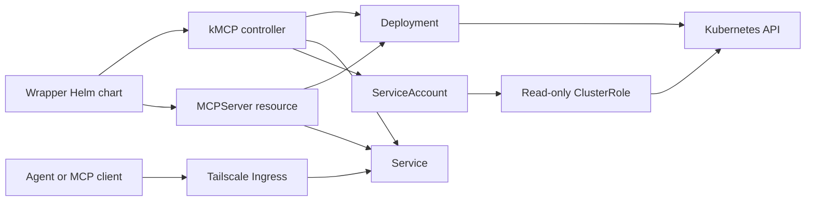

---

title: Overview
description: Understand what kMCP deploys into the cluster and the role it serves.
---

## What am I looking at?

kMCP is the shared platform for running MCP servers in the Kubernetes cluster.
It provides the upstream kMCP controller and the configuration for the MCP
servers that Nori Cloud makes available to agents and tools.

The platform is installed by the wrapper Helm chart at
`infra/services/kmcp/`. The chart depends on the upstream kMCP chart and keeps
our managed server definitions in `templates/`.

## How does it fit together?

## What does it deploy?

| Component                 | Definition                             | Role                                                                                                                 |
| ------------------------- | -------------------------------------- | -------------------------------------------------------------------------------------------------------------------- |
| kMCP controller           | Upstream `kmcp` chart dependency       | Watches `MCPServer` resources and reconciles their Deployments, Services, ServiceAccounts, and configuration.        |
| `kubernetes-readonly-mcp` | `templates/k8s-ro/server.yaml`         | Declares the read-only Kubernetes MCP server in the `argus` namespace.                                               |
| Read-only RBAC            | `templates/k8s-ro/rbac.yaml`           | Allows cluster inspection, logs, events, networking, storage, and metrics without Secret access or write operations. |
| Tailscale Ingress         | `templates/k8s-ro/ingress.yaml`        | Publishes the server at the `/mcp` endpoint on the tailnet.                                                          |
| Network policy            | `templates/k8s-ro/network-policy.yaml` | Limits inbound traffic to the approved cluster namespaces and MCP port.                                              |

The controller creates the workload resources from the `MCPServer` definition.
The wrapper chart supplies the server configuration, security boundaries, and
network entry point.

## What role does kMCP serve?

kMCP is an infrastructure service, not an application-specific MCP server. It
gives the cluster one control plane for MCP workloads, while each
`MCPServer` resource describes a separate server.

The current server provides read-only Kubernetes context to tools and agents.
Its permissions are intentionally limited to inspection and do not include
Secrets or create, update, patch, or delete operations.

## Which MCP servers are available?

| Server                    | Purpose                                                           | Documentation                                                                  |
| ------------------------- | ----------------------------------------------------------------- | ------------------------------------------------------------------------------ |
| `kubernetes-readonly-mcp` | Cluster-wide Kubernetes inspection without Secret or write access | [Kubernetes read-only MCP](/docs/infra/services/kmcp/mcps/kubernetes-readonly) |

## Is there any external references to this documentation?

- [kMCP documentation](https://kagent.dev/docs/kmcp/) - explains the controller
  and `MCPServer` resource.
