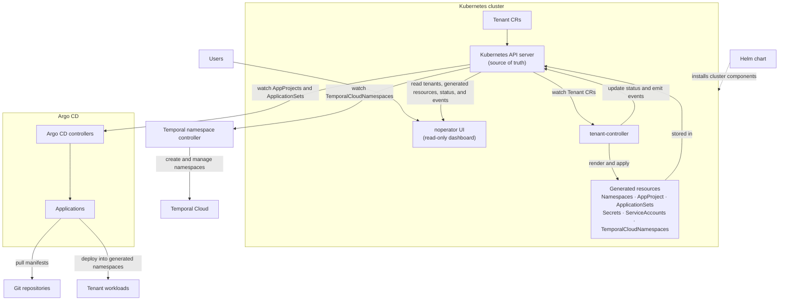

---

title: "Architecture"
description: "A high-level view of how users, the web UI, the Kubernetes operator, Argo CD, and Temporal Cloud work together. The Kubernetes API server is the system's"
---

## What am I looking at?

A high-level view of how users, the web UI, the Kubernetes operator, Argo CD,
and Temporal Cloud work together. The Kubernetes API server is the system's
source of truth: the UI reads tenant state from it, and the controllers store
their desired and observed resources there.

## How are tenants turned into workloads?

A user creates a `Tenant` custom resource. `tenant-controller` watches it,
resolves the extension registry, and applies the generated Kubernetes and Argo
CD resources. Argo CD then uses the generated `ApplicationSet` resources and
Git repositories to create and deploy tenant applications.

## Where does the web UI get its data?

The UI reads the `Tenant` resources and their generated resources from the
Kubernetes API server. This includes tenant status, Argo CD resources,
namespaces, Secrets with masked values, ServiceAccounts, and Kubernetes Events.
The UI does not deploy or reconcile resources.

## How is Temporal Cloud integrated?

When Temporal support is enabled on a `Tenant`, the operator creates one
`TemporalCloudNamespace` resource per environment. A Temporal namespace
controller watches those resources and reconciles them with Temporal Cloud.

## How is the system installed?

The Helm chart installs the controller, CRDs, RBAC, optional UI, extension
registry, and supporting Kubernetes resources. Optional chart integrations
include Prometheus monitoring, cert-manager certificates, and network policies.
