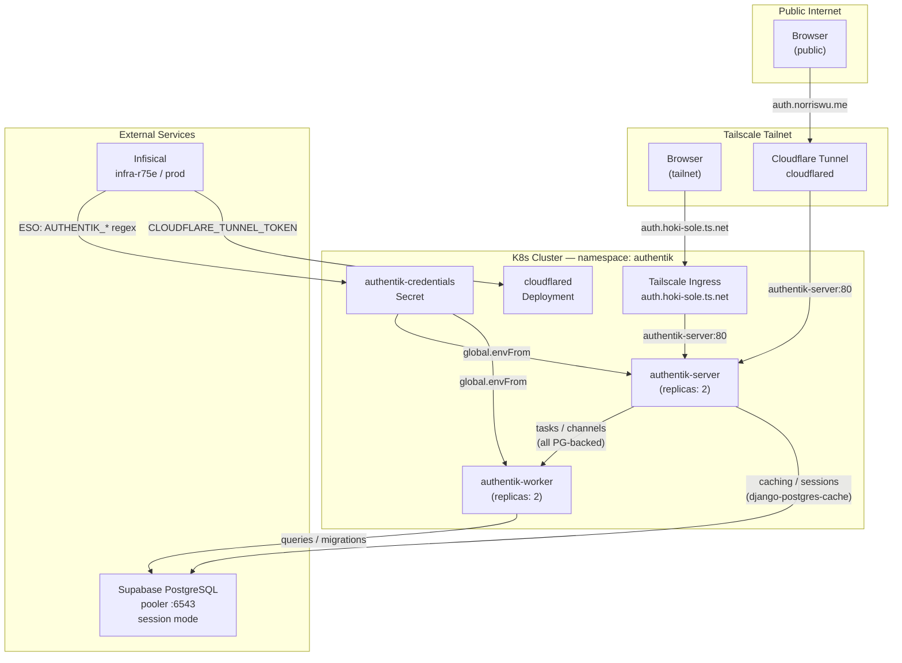

---

title: "Authentik: Database Migration & Version Upgrade Journal"
description: "We had an Authentik 2025.10.3 instance running on the home lab (../lab/home/_authentik) with:"
---

**Date**: August 1, 2026  
**Final Version**: 2026.5.6  
**Database**: Supabase (PostgreSQL via pooler, session mode)

---

## Starting Point

We had an Authentik 2025.10.3 instance running on the home lab (`../lab/home/_authentik`) with:

- Embedded Redis (chart default)
- External PostgreSQL (self-hosted)
- Traefik ingress on `authentik.home.norriswu.me`

The goal: bring Authentik into the new `nori-cloud` K8s cluster on Talos, upgrade to latest, and migrate the database to Supabase.

---

## Phase 1: Infrastructure Prerequisites

### Valkey

Since Authentik's original lab deployment used embedded Redis, we first deployed a standalone Valkey (Redis-compatible) instance as a cluster service. We chose the Bitnami Valkey chart (v6.2.4) over DragonflyDB or KeyDB — safest Redis compat guarantee.

**Pattern used**:

- Kustomize + Helm chart in `services/valkey/`
- Secrets via SealedSecrets → sealed-secrets controller → ESO → Infisical
- `VALKEY_PASSWORD` stored in Infisical, consumed by both Valkey auth and Authentik's `AUTHENTIK_REDIS__PASSWORD`

**Issue**: Repurposed `scripts/set-up-secret-store-creds.sh` to generate `kubeseal` SealedSecrets instead of live `kubectl create secret`. Now git-committable, no manual cluster setup.

### Cloudflare Tunnel

Deployed `cloudflared` as a sidecar in the `authentik` namespace. Tunnel routes `auth.norriswu.me` → `authentik-server.authentik.svc:80`. Configured fully in Cloudflare Zero Trust dashboard — no Gateway/HTTPRoute needed.

### Redis? Not needed.

**Discovery**: Authentik removed Redis entirely in 2025.10. Caching, tasks, WebSocket, and the embedded outpost all use PostgreSQL now. Valkey sat idle. We kept it for future use but removed `redis.enabled: false` from the Helm values — it's a no-op in 2025.10+.

---

## Phase 2: Version Upgrades

We did a sequential upgrade: 2025.10.3 → 2025.12.4 → 2026.2.x → 2026.5.6.

### 2025.10.3 → 2025.12.4

**Process**:

1. Bumped `version: 2025.12.4` in `kustomization.yaml`
2. Removed `redis.enabled: false` (setting removed in chart)
3. Argo CD `ServerSideApply` handled the rolling update

**Issue: Static File Mismatch**: After upgrade, the UI loaded HTML referencing 2025.12 chunk hashes, but `/static/dist/` still served 2025.10 chunks (404s). Root cause: rolling update had a brief window where the HTML-serving pod was new but static files weren't refreshed.

**Fix**: `kubectl rollout restart deploy/authentik-server -n authentik` → fresh pods with matching image + static files.

**Issue: PodSecurity Warnings**: Talos enforces `restricted` PSA profile. Authentik's pods ran fine as UID 1001 but generated warnings because `runAsNonRoot`, `allowPrivilegeEscalation`, `capabilities.drop`, and `seccompProfile` weren't explicitly declared.

**Fix**: Added `containerSecurityContext` blocks to both `server` and `worker` in `valuesInline`. Purely cosmetic hardening — no functional change.

### 2025.12.4 → 2026.2.0

**Breaking change**: `User.ak_groups` deprecated → `User.groups`. No impact — no custom expression policies using it.

**Issue: `'Version' object has no attribute '__dict__'`**

This was brutal. Python 3.14 ships `packaging.version.Version` as a C extension without `__dict__`. The `django-postgres-cache` backend (used since Redis was removed) tried to hash cache keys containing `Version` objects by accessing `__dict__` → `AttributeError`.

This manifested as 500 errors on `/api/v3/admin/version/` and outpost health checks — the admin dashboard was broken.

**Attempted fixes that didn't work**:

- `ak cache clear` → command doesn't exist
- `DELETE FROM django_postgres_cache_cacheentry` → stale data flushed, but error re-triggered (it was a live code path, not stale cache)
- Upgrading through 2026.2.1, 2026.2.2, 2026.2.3 → bug persisted across all 2026.2.x patches

**Actual fix**: Upgraded to 2026.5.6. The release rewrites `django-postgres-cache` to use Django's ORM instead of raw SQL. The ORM properly handles serialization without touching `__dict__`.

### 2026.2.3 → 2026.5.6

Clean upgrade. No breaking changes affecting us:

- Listen address changed from `0.0.0.0` to `[::]` (Helm chart handles it)
- PostgreSQL custom connection options deprecated (we never used them)

Single line change: `version: 2026.5.6`. Pushed, synced, done.

---

## Phase 3: Database Migration (PG VM → Supabase)

### IPv6 Bites

Supabase's direct hostname (`db.llxqxbwmsqrehdxohmqj.supabase.co`) resolves **only** to IPv6 AAAA records. Our K8s nodes (Talos on Proxmox via Tailscale) have no global IPv6 address, no default IPv6 route. Direct connection impossible from both host and pods.

**Attempted fix**: CoreDNS AAAA-block rule for `supabase.co`. Went badly — malformed YAML in the `kubectl patch` mangled the Corefile, temporarily breaking cluster DNS. Rolled back via `kubectl replace --force`. Lesson learned: CoreDNS patches via inline YAML are fragile — use proper manifests.

**Actual fix**: Use Supabase's pooler.

### Pooler Mode: Transaction vs. Session

Initially used pooler in **Transaction** mode (default):

- **Error**: `prepared statement "..." already exists (SQLSTATE 42P05)` — PgBouncer routes each transaction to different backends, prepared statements don't survive across connections.
- **Error**: `WITHIN GROUP is required for ordered-set aggregate mode (SQLSTATE 42809)` — PgBouncer in transaction mode mangles Django's SQL patterns.

**Fix**: Switched pooler to **Session** mode in Supabase Dashboard (Settings → Database → Connection Pooling → Session mode → port 6543). Session mode maintains a dedicated backend connection per client session — no prepared statement collisions, no SQL mangling.

### Clean Restore

Ran `pg_restore` but hit duplicate schema errors — a previous failed restore left partial tables on Supabase.

**Fix**: Updated `scripts/migrate-to-supabase.sh` with a `prepare_supabase()` function that drops all tables, sequences, and types from `public` before restore. Added `--clean --if-exists` to `pg_restore` flags. 5 harmless "trigger does not exist" warnings (already dropped by CASCADE), 0 data errors.

**Connection details for Infisical**:

```
AUTHENTIK_POSTGRES_HOST = aws-0-ap-southeast-2.pooler.supabase.com
AUTHENTIK_POSTGRES_PORT = 6543
AUTHENTIK_POSTGRES_USER = postgres.llxqxbwmsqrehdxohmqj
AUTHENTIK_POSTGRES_NAME = postgres
```

---

## Architecture



---

## Key Takeaways

1. **Upgrade sequentially, don't skip**: Authentik 2025.10 → 2025.12 → 2026.2 → 2026.5. Skipping 2025.12's RBAC migration would have caused issues (even if fresh install).
2. **Python 3.14 breaks `packaging.Version`**: Any Django app using `django-postgres-cache` with Python 3.14 will hit this. The fix arrived in 2026.5 with the ORM rewrite.
3. **Supabase pooler defaults are wrong for Django**: Always use session mode. Transaction mode = prepared statement collisions + SQL mangling.
4. **Direct Supabase connections are IPv6-only**: If your infra is IPv4, you're on the pooler whether you like it or not.
5. **CoreDNS patches are dangerous as inline YAML**: Next time, use a proper ConfigMap manifest and `kubectl replace`.
6. **SealedSecrets > direct `kubectl create secret`**: Repurposing `set-up-secret-store-creds.sh` to generate `kubeseal` output made Infisical credentials git-committable.
7. **Valkey is deployed but not used**: Authentik hasn't needed Redis since 2025.10. Keep it for future apps.
8. **PodSecurity profiles are warnings, not errors**: Talos `restricted` PSA doesn't block pods — it nags. Adding `containerSecurityContext` silences it with no functional change.
