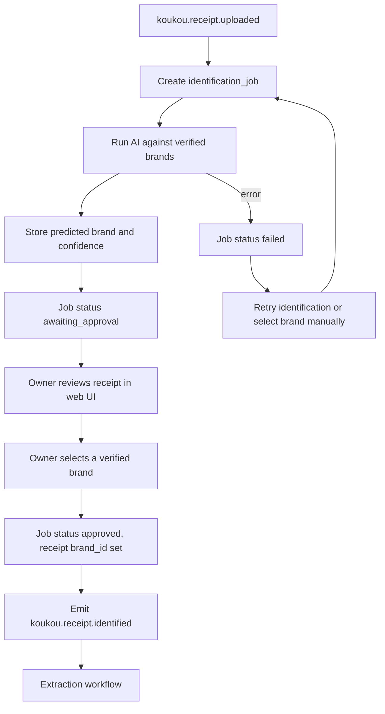

---

title: "Backlog: Automated Brand Detection"
description: "Status: Deferred"
---

Status: Deferred

## Motivation

The MVP requires the owner to select a verified brand when creating a receipt.
This is simple and accurate but adds manual work and fails when the owner does
not know the merchant.

Automated brand detection uses the receipt image to suggest a brand, reducing
manual selection and opening the door to fully automated processing once
accuracy is proven.

## Proposed Flow

## Data Model

### `identification_job`

| Column               | Notes                                                                        |
| -------------------- | ---------------------------------------------------------------------------- |
| `id`                 | UUID                                                                         |
| `receipt_id`         | FK to receipt                                                                |
| `attempt`            | Monotonic per receipt; a retry inserts a new row                             |
| `status`             | `queued \| running \| awaiting_approval \| approved \| superseded \| failed` |
| `predicted_brand_id` | FK to brand, nullable; the AI suggestion                                     |
| `confidence`         | Numeric; stored as a metric, not a routing rule                              |
| `model`              | Model identifier                                                             |
| `raw_response`       | JSONB; original provider response                                            |
| `error`              | Nullable                                                                     |
| timestamps           | `started_at`, `completed_at`, `created_at`                                   |

`receipt.brand_id` becomes optional instead of required. It is set only by human
approval.

## Events

| Event                       | Trigger                          | Consumer          |
| --------------------------- | -------------------------------- | ----------------- |
| `koukou.receipt.identified` | Owner approves a suggested brand | Extraction worker |

The existing `koukou.receipt.uploaded` event gains a branch: if a brand was
provided at upload, skip detection; otherwise start an identification job.

## Decisions Carried Over

- Candidates and review choices are verified brands only.
- Detection never auto-creates a brand.
- Detection never sets `receipt.brand_id`; only human approval does.
- Confidence is captured for evaluation, not used to auto-approve.
- Review is pull-based; the owner opens a pending list rather than receiving an
  event.
- Each run is its own `identification_job` row; retries mark the previous row
  `superseded`.

## Open Questions

- Should the AI still run when the owner supplies a brand, to collect accuracy
  metrics?
- What confidence and sample thresholds justify auto-approval later?
- Should job input snapshots (prompt text, candidate list) be stored for
  reproducibility?
