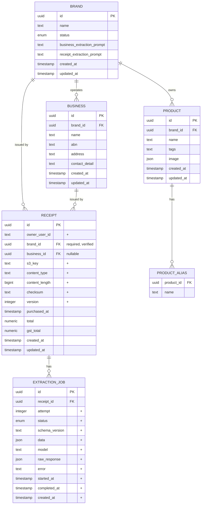

---

title: "Entity Relationship Diagram"
description: "Status: Draft"
---

Status: Draft

Working notes for the receipt data model. Fields marked `+` are proposed and not
yet in `apps/boubou/src/database/schema.ts`.



## Field Notes

### `receipt`

- `owner_user_id` replaces the current `user_id`. Ownership will later move behind
  an account entity, but that is deferred.
- `brand_id` is required and must reference a verified brand. The owner selects it
  when creating the receipt. There is no `unknown` brand row.
- There is no `status` column. Receipt status is derived in the service layer from
  `s3_key` and `extraction_job`.
- `version` supports optimistic concurrency.
- `content_type`, `content_length`, and `checksum` are captured when upload
  completion is verified against S3.

### `extraction_job`

- One row per extraction run. A retry inserts a new row with the next `attempt`.
- `status`: `queued | running | completed | superseded | failed`.
- `schema_version` records the extraction contract version used.
- `data` stores the validated extraction output as JSON:

```text
{
  date,
  merchant: { name, abn, address, contactDetail },
  lineItems: [ { name, qty, size, sizeUnit, price, priceType, gstFree } ],
  total,
  gstTotal
}
```

- `lineItems` follow `lineItemSchema` in
  `packages/boubou-client/src/schemas/receipt.ts`.
- `total` and `gstTotal` are computed by the pipeline, not returned by the model.
  The brand prompt canonicalizes the pricing basis so one formula applies.
- `merchant` is stored in the job only. It is not linked to a business record.
- See [extraction job](/docs/projects/koukou/extraction-job) for the full contract.

### Derived receipt status

Computed in the service layer, never stored:

| Derived status   | Rule                                       |
| ---------------- | ------------------------------------------ |
| `pending_upload` | `s3_key IS NULL`                           |
| `processing`     | current extraction job in `queued/running` |
| `processed`      | current extraction job `completed`         |
| `failed`         | current extraction job `failed`            |

"Current job" means the highest `attempt`. `s3_key` must only be written after S3
verification so `pending_upload` inference stays correct.

### `brand`

- `receipt_extraction_prompt` is loaded by the extraction job.
- A brand with no prompt fails extraction fast.
- `status` (`unverified | verified`) gates which brands can be selected on upload.

### Deferred

- Automated brand detection. See
  [automated brand detection](/docs/projects/koukou/backlog/overview).
- Job input snapshots and prompt versioning.
- Account and membership model for shared ownership.
- `extraction-failed` event.
- Analytics projections from `extraction_job.data`.
