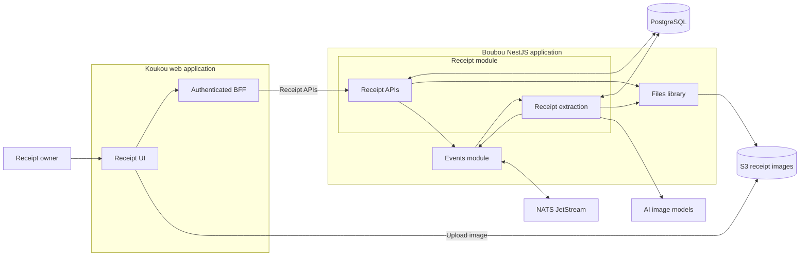
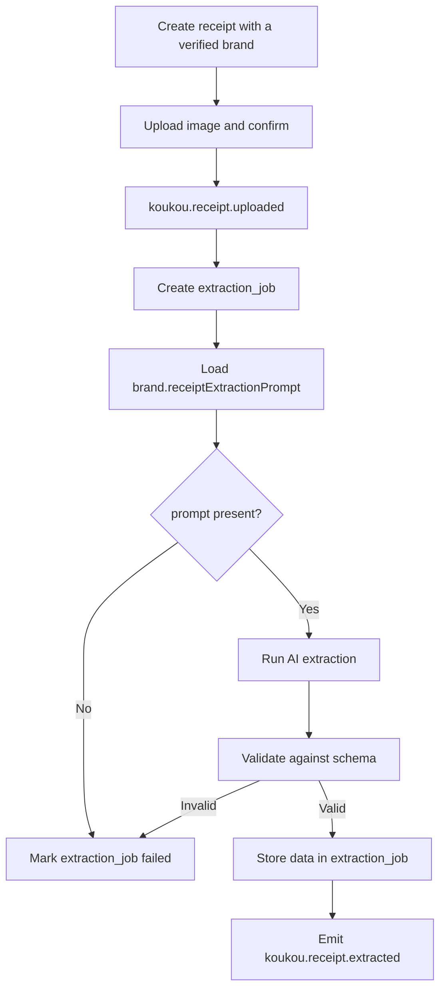

---

title: "Receipt Analysis Pipeline"
description: "Status: Draft"
---

Status: Draft

## What does the architecture look like?

## What does the processing flow look like?

The owner selects a verified brand when creating the receipt, so the pipeline
does not need to identify a brand. Upload confirmation emits
`koukou.receipt.uploaded`, which starts extraction. Extraction loads the brand's
`receiptExtractionPrompt`, runs the model, validates the output against the
extraction schema, computes receipt totals, and stores the result in its
`extraction_job`. See [extraction job](/docs/projects/koukou/extraction-job) for the contract.

Extraction fails when the brand has no configured extraction prompt or the model
output does not match the extraction schema. A failed run marks its
`extraction_job` as failed and emits nothing.

## What events are being emitted?

| Event                      | Producer                            | Consumer                    | When emitted                                                  |
| -------------------------- | ----------------------------------- | --------------------------- | ------------------------------------------------------------- |
| `koukou.receipt.uploaded`  | Receipt module (upload API)         | Receipt module (extraction) | The receipt image has been uploaded and confirmed.            |
| `koukou.receipt.extracted` | Receipt module (receipt extraction) | Future consumers            | Extraction succeeded and validated JSON is stored in its job. |

Events are thin notifications that carry only identifiers such as `receiptId` and
`jobId`. Payloads live in PostgreSQL job tables, not in the stream.

Automated brand detection is deferred. See
[automated brand detection](/docs/projects/koukou/backlog/overview).
