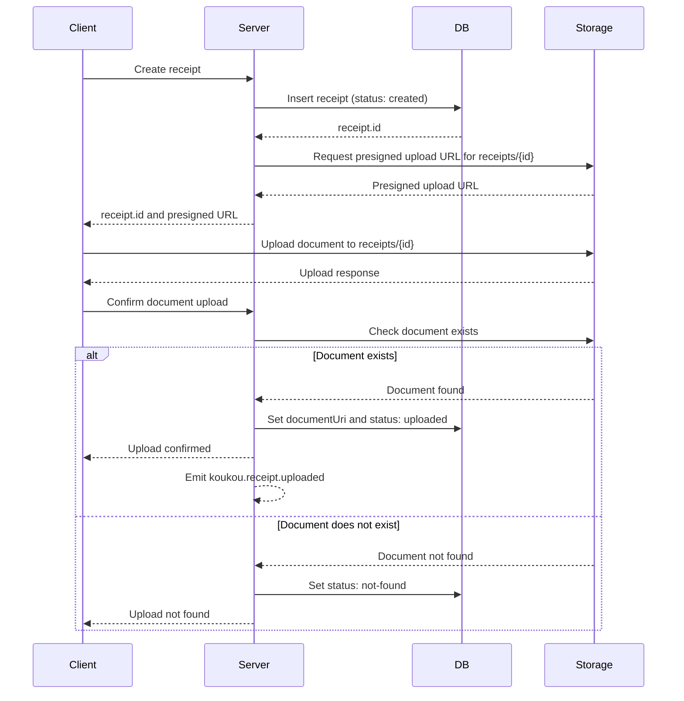

---

title: "Create a Receipt"
description: "Create a receipt and upload its document."
---

## What am I looking at?

This workflow creates a receipt, uploads its document to storage, and emits an
event after the upload is confirmed.

The upload confirmation is idempotent. Repeating it after the receipt is
`uploaded` or `not-found` does not create another state transition.

The `documentUri` stores the provider-neutral object key `receipts/{id}`. The
event contains the `receiptId`; processing the event is handled by a separate
workflow.
