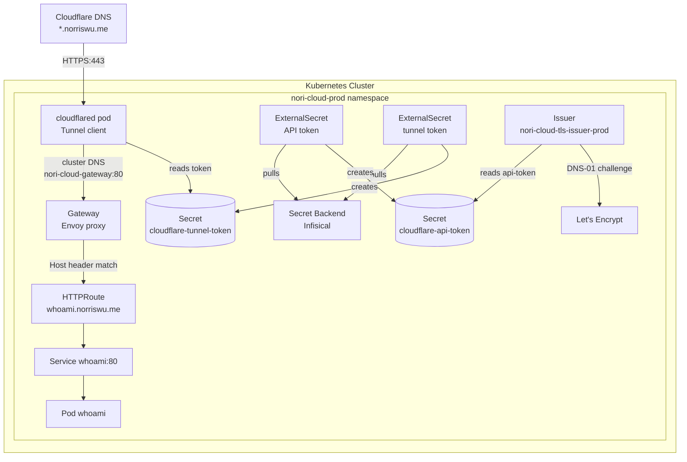

---

title: "How to Set Up a Public Gateway to Expose Workloads to the Public Internet"
description: "Your workloads run happily inside Kubernetes, but they are only reachable from within the cluster. You want to expose them to the public internet over HTTPS..."
---

## What Problem Does This Solve?

Your workloads run happily inside Kubernetes, but they are only reachable from within the cluster. You want to expose them to the public internet over HTTPS — without a cloud LoadBalancer and without manual certificate management.

This guide walks through wiring up **kgateway** (Gateway API), **cert-manager**, and **Cloudflare Tunnel** so that `https://whoami.norriswu.me` serves a Kubernetes pod from the public internet.

|         | Before                           | After                        |
| ------- | -------------------------------- | ---------------------------- |
| Access  | Cluster-internal only            | Public internet via HTTPS    |
| Routing | Port-forwards or VPN per service | One Gateway, many HTTPRoutes |
| DNS     | Cluster DNS only                 | Cloudflare DNS               |

## What Do You Need Before Following This Guide?

### Project layout

This guide assumes a Kustomize-based GitOps repo synced by ArgoCD:

```
apps/
├── network/              # shared networking infra (deploy once per environment)
│   ├── base/             #   raw manifests
│   │   ├── kustomization.yaml
│   │   ├── external-secret-api-token.yaml
│   │   ├── external-secret-tunnel-token.yaml
│   │   ├── issuer.yaml
│   │   ├── gateway-parameters.yaml
│   │   ├── gateway.yaml
│   │   └── cloudflared.yaml
│   └── overlays/prod/
│       └── kustomization.yaml    # sets namespace: nori-cloud-prod
└── whoami/               # example app (repeat this pattern per workload)
    ├── base/
    │   ├── kustomization.yaml
    │   ├── deployment.yaml
    │   ├── service.yaml
    │   └── httproute.yaml
    └── overlays/prod/
        └── kustomization.yaml    # sets namespace: nori-cloud-prod
```

Each overlay's `kustomization.yaml` sets the namespace:

```yaml
# network/overlays/prod/kustomization.yaml
apiVersion: kustomize.config.k8s.io/v1beta1
kind: Kustomization
namespace: nori-cloud-prod
resources:
  - ../../base
```

ArgoCD watches the repo and applies whichever overlay you point it at. All resources for a project live in a single namespace.

### Cluster infrastructure

These must already be installed in your cluster (provided by your cluster platform). Verify with:

```bash
kubectl get gatewayclass kgateway            # should show ACCEPTED=True
kubectl get crd certificates.cert-manager.io # cert-manager CRD exists
kubectl -n nori-cloud-prod get secretstore   # SecretStore exists (ESO)
```

- **[kgateway](https://github.com/kgateway-dev/kgateway)** — Gateway API implementation (creates Envoy proxies from `Gateway` resources)
- **[cert-manager](https://cert-manager.io/)** — automatic TLS certificate issuance and renewal
- **[External Secrets Operator](https://external-secrets.io/)** — pulls secrets from your secret backend into Kubernetes `Secret` objects. Your cluster platform provides a `SecretStore` or `ClusterSecretStore` configured for your provider (Infisical, AWS Secrets Manager, Vault, etc.).

The platform provides a `SecretStore` named `nori-cloud-secret-store` in the `nori-cloud-prod` namespace.

### Cloudflare account and knowledge

- A domain managed by Cloudflare (`norriswu.me`)
- Cloudflare Zero Trust enabled
- Familiarity with creating a Cloudflare Tunnel and configuring public hostname routes in the Cloudflare Zero Trust dashboard

### Secrets in your secret backend

Two secrets must exist in your backend before deploying:

| Path                       | Purpose                                                |
| -------------------------- | ------------------------------------------------------ |
| `/cloudflare/API_TOKEN`    | Cloudflare API token with DNS edit permissions         |
| `/cloudflare/TUNNEL_TOKEN` | Cloudflare Tunnel token for cloudflared authentication |

The `SecretStore` handles provider/project scoping, so these paths are relative to what your SecretStore is configured for.

## How Does It Work?

### Encryption model

```
                    Cloudflare encrypts this                   |  Our cluster
┌──────────┐  TLS  ┌──────────────────┐  Tunnel  ┌──────────┐  |  ┌──────────┐  ┌──────────┐
│ Browser  │──▶──▶│ Cloudflare Edge  │──▶──▶──▶│cloudflared│  |  │ Gateway  │  │ backend  │
└──────────┘       └──────────────────┘          └──────────┘  |  └──────────┘  └──────────┘
      ✓                      ✓                       ✓         |       ✗            ✗
```

| Hop                           | Encrypted?     | How                                                              |
| ----------------------------- | -------------- | ---------------------------------------------------------------- |
| Browser → Cloudflare Edge     | ✓              | Cloudflare Universal SSL (automatic)                             |
| Cloudflare Edge → cloudflared | ✓              | Cloudflare Tunnel protocol (QUIC)                                |
| cloudflared → Gateway         | ✗ (acceptable) | Plain HTTP inside pod network — tunnel already encrypts this leg |
| Gateway → backend pod         | ✗ (gap)        | Plain HTTP — address with per-workload TLS                       |

The Gateway-to-backend gap is where per-workload TLS should go: cert-manager issues a `Certificate` per app, the pod serves HTTPS, and the Gateway originates TLS to the backend via `BackendTLSPolicy`. This guide covers the networking foundation; per-workload TLS is the natural next step.

### Architecture



**Flow:**

1. A user hits `https://whoami.norriswu.me`. Cloudflare terminates edge TLS and forwards through the encrypted tunnel.
2. The `cloudflared` pod receives tunnel traffic and forwards it to the Gateway via cluster DNS (`nori-cloud-gateway:80`).
3. The Gateway inspects the `Host` header, matches the `HTTPRoute` for `whoami.norriswu.me`, and forwards to the `whoami` Service → Pod.
4. ExternalSecrets pull Cloudflare credentials from the secret backend into Kubernetes `Secret` objects. cloudflared and the cert-manager `Issuer` read from those Secrets when needed.

## How Do You Set It Up?

### Before you begin — create the Cloudflare Tunnel

Go to **Cloudflare Zero Trust > Networks > Tunnels**, create a tunnel, and save the tunnel token. Store it in your secret backend at `/cloudflare/TUNNEL_TOKEN`.

Also create a Cloudflare API token with **Zone > DNS > Edit** permissions and store it at `/cloudflare/API_TOKEN`.

### Step 1 — Pull Cloudflare Secrets from Your Secret Backend

`external-secret-api-token.yaml`

```yaml
apiVersion: external-secrets.io/v1
kind: ExternalSecret
metadata:
  name: cloudflare-api-token
spec:
  refreshInterval: 1h
  secretStoreRef:
    name: nori-cloud-secret-store
    kind: SecretStore
  target:
    name: cloudflare-api-token
  data:
    - secretKey: api-token
      remoteRef:
        key: /cloudflare/API_TOKEN
```

`external-secret-tunnel-token.yaml`

```yaml
apiVersion: external-secrets.io/v1
kind: ExternalSecret
metadata:
  name: cloudflare-tunnel-token
spec:
  refreshInterval: 1h
  secretStoreRef:
    name: nori-cloud-secret-store
    kind: SecretStore
  target:
    name: cloudflare-tunnel-token
  data:
    - secretKey: token
      remoteRef:
        key: /cloudflare/TUNNEL_TOKEN
```

> **What this does:** Each `ExternalSecret` pulls a value from the secret backend into a Kubernetes `Secret`. The backend key maps directly to the Secret key. The `cloudflare-api-token` Secret (key `api-token`) is used by cert-manager for DNS-01 challenges. The `cloudflare-tunnel-token` Secret (key `token`) is used by cloudflared for authentication.

### Step 2 — Set Up cert-manager Issuer

`issuer.yaml`

```yaml
apiVersion: cert-manager.io/v1
kind: Issuer
metadata:
  name: nori-cloud-tls-issuer-prod
spec:
  acme:
    email: me@norriswu.me
    server: https://acme-v02.api.letsencrypt.org/directory
    privateKeySecretRef:
      name: nori-cloud-tls-issuer-prod-key
    solvers:
      - dns01:
          cloudflare:
            apiTokenSecretRef:
              name: cloudflare-api-token
              key: api-token
```

> **What this does:** Creates an `Issuer` that workloads can reference when requesting TLS certificates. It uses Let's Encrypt's production ACME endpoint and proves domain ownership via a DNS-01 challenge against Cloudflare (using the API token from step 1). No `Certificate` is created yet — each workload requests its own when ready for Gateway-to-backend TLS.

> Use `https://acme-staging-v02.api.letsencrypt.org/directory` for testing to avoid hitting Let's Encrypt's production rate limits. Delete and re-create the Issuer when switching between staging and production.

### Step 3 — Create the Gateway

`gateway-parameters.yaml`

```yaml
apiVersion: gateway.kgateway.dev/v1alpha1
kind: GatewayParameters
metadata:
  name: nori-cloud-gateway-params
spec:
  kube:
    service:
      type: ClusterIP
```

`gateway.yaml`

```yaml
apiVersion: gateway.networking.k8s.io/v1
kind: Gateway
metadata:
  name: nori-cloud-gateway
spec:
  gatewayClassName: kgateway
  infrastructure:
    parametersRef:
      group: gateway.kgateway.dev
      kind: GatewayParameters
      name: nori-cloud-gateway-params
  listeners:
    - name: http
      port: 80
      protocol: HTTP
      allowedRoutes:
        namespaces:
          from: Same
```

> **What this does:** The `Gateway` tells kgateway to provision an Envoy proxy with an HTTP listener on port 80. Cloudflared forwards tunnel traffic here via cluster DNS. The `GatewayParameters` sets the backing Service to `ClusterIP` — no external LoadBalancer needed since traffic arrives through the tunnel.
>
> `allowedRoutes.namespaces.from: Same` means only `HTTPRoute` resources in the same namespace (`nori-cloud-prod`) can attach to this Gateway. This keeps routing scoped to the project namespace.

### Step 4 — Deploy Cloudflare Tunnel

`cloudflared.yaml`

```yaml
apiVersion: apps/v1
kind: Deployment
metadata:
  name: cloudflared
  labels:
    app: cloudflared
spec:
  replicas: 2
  selector:
    matchLabels:
      app: cloudflared
  template:
    metadata:
      labels:
        app: cloudflared
    spec:
      containers:
        - name: cloudflared
          image: cloudflare/cloudflared:latest
          args:
            - tunnel
            - --no-autoupdate
            - --loglevel
            - debug
            - --metrics
            - 0.0.0.0:2000
            - run
          env:
            - name: TUNNEL_TOKEN
              valueFrom:
                secretKeyRef:
                  name: cloudflare-tunnel-token
                  key: token
          livenessProbe:
            httpGet:
              path: /ready
              port: 2000
            initialDelaySeconds: 10
            periodSeconds: 30
          readinessProbe:
            httpGet:
              path: /ready
              port: 2000
            initialDelaySeconds: 5
            periodSeconds: 10
```

> **What this does:** Runs cloudflared inside the cluster, authenticating with the tunnel token. The `--metrics` flag exposes a `/ready` endpoint on port 2000 for Kubernetes probes. Consider pinning the image to a SHA digest (`cloudflare/cloudflared@sha256:...`) for reproducible deployments.

> **Cloudflare Dashboard route:** After deploying, go to **Cloudflare Zero Trust > Networks > Tunnels**, select your tunnel, and add a **Public Hostname**:
>
> | Field           | Value                                                     |
> | --------------- | --------------------------------------------------------- |
> | Public hostname | `*.norriswu.me`                                           |
> | Service type    | HTTP                                                      |
> | URL             | `nori-cloud-gateway.nori-cloud-prod.svc.cluster.local:80` |
>
> Using a wildcard public hostname (`*.norriswu.me`) means every subdomain routes through the tunnel to the Gateway — individual apps only need a new `HTTPRoute`, no tunnel changes.

### Step 5 — Deploy an App with an HTTPRoute

`deployment.yaml`

```yaml
apiVersion: apps/v1
kind: Deployment
metadata:
  name: whoami
  labels:
    app: whoami
spec:
  replicas: 1
  selector:
    matchLabels:
      app: whoami
  template:
    metadata:
      labels:
        app: whoami
    spec:
      containers:
        - name: whoami
          image: traefik/whoami:latest
          ports:
            - containerPort: 80
```

`service.yaml`

```yaml
apiVersion: v1
kind: Service
metadata:
  name: whoami
spec:
  ports:
    - port: 80
      targetPort: 80
  selector:
    app: whoami
```

`httproute.yaml`

```yaml
apiVersion: gateway.networking.k8s.io/v1
kind: HTTPRoute
metadata:
  name: whoami
spec:
  parentRefs:
    - name: nori-cloud-gateway
      sectionName: http
  hostnames:
    - whoami.norriswu.me
  rules:
    - backendRefs:
        - name: whoami
          port: 80
```

> **What this does:** A minimal `Deployment` + `Service` for the `traefik/whoami` echo server (used for testing). The `HTTPRoute` attaches to the Gateway's `http` listener: any request with `Host: whoami.norriswu.me` gets forwarded to the `whoami` service on port 80.

## How Do You Verify It Works?

### Check resource health

```bash
# Secrets synced from secret backend?
kubectl -n nori-cloud-prod get secret cloudflare-api-token cloudflare-tunnel-token

# Issuer ready?
kubectl -n nori-cloud-prod get issuer nori-cloud-tls-issuer-prod
# Look for: READY=True

# Gateway programmed?
kubectl -n nori-cloud-prod get gateway nori-cloud-gateway
# Look for: PROGRAMMED=True

# Cloudflared connected?
kubectl -n nori-cloud-prod get pod -l app=cloudflared
kubectl -n nori-cloud-prod logs -l app=cloudflared | grep -i "registered tunnel"

# App running?
kubectl -n nori-cloud-prod get pod -l app=whoami

# Route accepted?
kubectl -n nori-cloud-prod get httproute whoami
# Look for: ACCEPTED=True
```

### Test internally (from within the cluster)

```bash
kubectl -n nori-cloud-prod run curl-test --image=curlimages/curl:latest -it --rm -- \
  curl -s -H "Host: whoami.norriswu.me" http://nori-cloud-gateway.nori-cloud-prod.svc.cluster.local
```

You should see the whoami response showing request headers and the serving pod's hostname.

### Test externally (from the public internet)

> Make sure the Cloudflare Dashboard public hostname route (from Step 4) has been configured first.

```bash
curl -s https://whoami.norriswu.me
```

> DNS propagation for the wildcard hostname may take a few minutes after the Cloudflare tunnel route is first created.

To inspect the TLS certificate served to users:

```bash
openssl s_client -connect whoami.norriswu.me:443 -servername whoami.norriswu.me </dev/null 2>/dev/null | \
  openssl x509 -noout -issuer -subject -dates
```

This shows Cloudflare's Universal SSL certificate — the certificate your users see.

## How Do You Add More Services?

No tunnel or certificate changes needed. Create a new module following the `whoami/` pattern:

1. Create a new directory `myapp/` with `base/` and `overlays/prod/`.
2. Add `deployment.yaml`, `service.yaml`, `httproute.yaml`, and `kustomization.yaml` files in `base/`.
3. Add an `overlays/prod/kustomization.yaml` that sets the namespace and references `../../base`.
4. Add an ArgoCD Application pointing at `myapp/overlays/prod`.
5. ArgoCD picks it up and deploys.

```yaml
# myapp/base/httproute.yaml
apiVersion: gateway.networking.k8s.io/v1
kind: HTTPRoute
metadata:
  name: myapp
spec:
  parentRefs:
    - name: nori-cloud-gateway
      sectionName: http
  hostnames:
    - myapp.norriswu.me
  rules:
    - backendRefs:
        - name: myapp
          port: 8080
```

To add Gateway-to-backend TLS for a workload (encrypt the rightmost hop), provision a cert-manager `Certificate` in the app's base, configure the pod to serve HTTPS, and add a `BackendTLSPolicy` to the namespace so the Gateway trusts the backend cert. Guide for this pattern is a separate topic.
