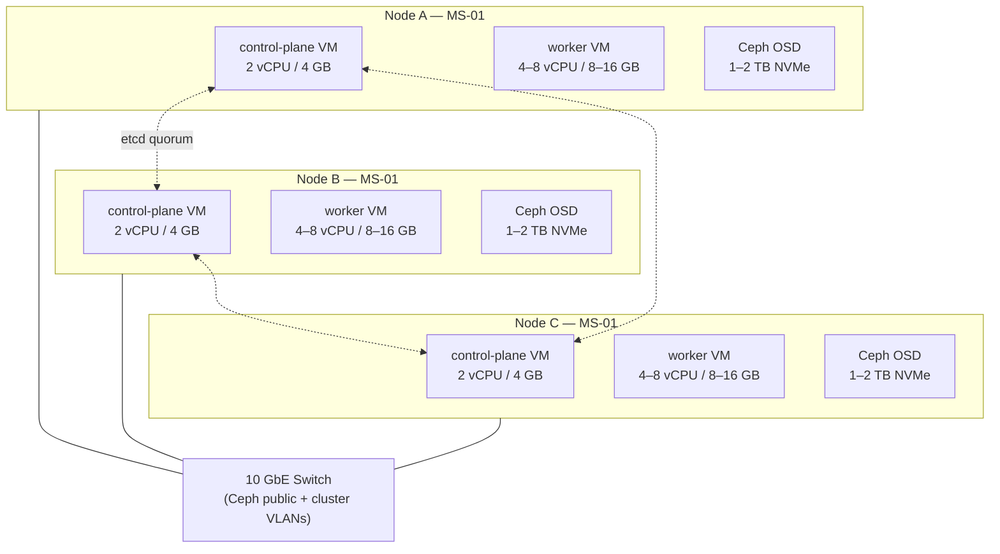
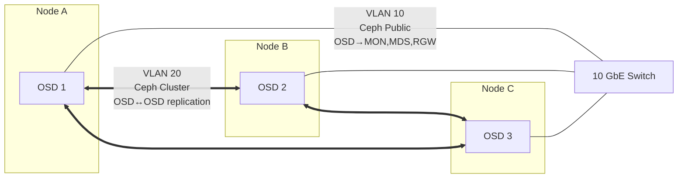

---

title: "Infrastructure Design — Nori-Cloud HA Cluster"
description: "| VM | vCPU | RAM | Per-node Cores | Per-node RAM | |--------------|------|-----|----------------|--------------|"
---

## 1. Topology



**3 physical Proxmox nodes** each running:

| VM                     | vCPU | RAM     | Per-node Cores | Per-node RAM     |
| ---------------------- | ---- | ------- | -------------- | ---------------- |
| Control-plane          | 2    | 4 GB    | 6              | 12 GB + overhead |
| Worker                 | 4-8  | 8-16 GB |                |                  |
| _Ceph OSD_ (colocated) | 2-4  | 4-8 GB  | reserved       | reserved         |

Total per physical node: 8 vCPU + Ceph overhead, 64 GB RAM recommended.

---

## 2. Compute

### Current inventory

| Asset | Model            | CPU               | RAM | Disk                       | Networking                  |
| ----- | ---------------- | ----------------- | --- | -------------------------- | --------------------------- |
| 1x    | Minisforum MS-01 | i9-13900H 14C/20T | ??? | 500 GB NVMe (Samsung 980?) | 2x 10GbE (X710) + 1x 2.5GbE |

### Target (per-node)

Each physical node should match or closely match the MS-01 for consistent scheduling:

| Component     | Spec                                     | Rationale                                                   |
| ------------- | ---------------------------------------- | ----------------------------------------------------------- |
| **CPU**       | ≥12 cores / 20 threads                   | 4 threads CP + 8-16 threads worker + 4 threads Ceph OSD     |
| **RAM**       | 64 GB DDR5 (2×32 GB SODIMM)              | 16 GB VMs + 36 GB Ceph cache/flush + 12 GB Proxmox overhead |
| **Boot disk** | 256 GB NVMe (mirror, 2×128 GB or single) | Proxmox root + ISOs + backups                               |
| **Ceph OSD**  | 1-2 TB NVMe ×1 per node                  | Dedicated block device per node, no partitions              |

**Why 3 identical nodes?**

- Ceph needs ≥3 OSD nodes for `size=3/min_size=2` replication.
- etcd needs odd-numbered control-plane for quorum.
- Matching hardware means predictable scheduling and balanced Ceph PG distribution.

### MS-01 specific notes

- PCIe x16 slot: can take a dual-NVMe carrier card (e.g. ASUS Hyper M.2, 4×4 bifurcation) for 2 additional NVMe drives.
- 2×10GbE SFP+ built in — no extra NIC purchase needed.
- Thermal: the MS-01 can run warm under sustained Ceph I/O. See §4.

---

## 3. Storage — Ceph (Rook)

### Why Ceph?

| Criterion             | Ceph via Rook                                  | Longhorn    | OpenEBS (Mayastor)     |
| --------------------- | ---------------------------------------------- | ----------- | ---------------------- |
| Replication           | block (RBD), filesystem (CephFS), object (RGW) | block only  | block only             |
| Maturity              | production at Hyper-scale                      | simpler ops | NVMe-only, less mature |
| Snapshots/Clones      | yes                                            | yes         | basic                  |
| PV topology awareness | yes                                            | yes         | yes                    |
| Ops complexity        | ~high~ manageable via Rook                     | low         | medium                 |
| 10GbE requirement     | **strongly recommended**                       | optional    | recommended            |

Verdict: your MS-01 has 10GbE built-in, you're already targeting 3 physical nodes → Ceph is the right choice.

### Ceph CRUSH map design

```
failure domain: host (each MS-01 = 1 failure domain)
replication: size=3, min_size=2
PGs: autoscaler on, target PG per OSD ~100
```

**Placement groups rule of thumb:**

```
total PGs = (OSDs × 100) / replication
          = (3 × 100) / 3 = ~100 PGs (start small, autoscaler grows)
```

### Block device plan per node

```
nvme0n1    256 GB     Proxmox root (ext4/ZFS single-disk)
nvme1n1    1-2 TB     Ceph OSD (raw block device, no LVM or FS)
```

**Do not** use the same NVMe for Proxmox boot and Ceph OSD. Ceph latency spikes under GC on shared media.

### Storage classes to expose

| StorageClass         | Backend          | Use                                            |
| -------------------- | ---------------- | ---------------------------------------------- |
| `ceph-block`         | RBD (image-mode) | PVC for PostgreSQL (CloudNativePG), containers |
| `ceph-block-erasure` | RBD EC 2+1       | Bulk / archive data (lower overhead than 3×)   |
| `ceph-filesystem`    | CephFS           | ReadWriteMany volumes (shared configs, media)  |

### Network design — Ceph public vs cluster



- **Public network** (VLAN 10): Ceph clients (RBD, CephFS, RGW) → MON, OSD, MDS
- **Cluster network** (VLAN 20): OSD → OSD replication heartbeat, backfill, recovery

On the MS-01, assign **one 10GbE port per VLAN** (two SFP+ ports available). On a managed switch, configure both VLANs tagged on the trunk port to each node.

### Upgrade path — adding storage

| Phase                    | Action                                                  | Capacity                                  |
| ------------------------ | ------------------------------------------------------- | ----------------------------------------- |
| **1. Minimum**           | 1× 1-2 TB NVMe per node (3 total, already on hand)      | ~2 TB usable (size=3)                     |
| **2. NVMe carrier card** | Add ASUS Hyper M.2 in PCIe x16 → 2 additional 2 TB NVMe | ~6 TB usable                              |
| **3. Third MS-01 batch** | Scale to 5 nodes                                        | ~10 TB usable + better CRUSH distribution |

---

## 4. Power & Cooling

### Power estimate

| Component                          | Idle (W) | Load (W) | Qty | Total Idle (W) | Total Load (W) |
| ---------------------------------- | -------- | -------- | --- | -------------- | -------------- |
| Minisforum MS-01                   | 15       | 50       | 3   | 45             | 150            |
| 10GbE managed switch (e.g. CRS305) | 10       | 18       | 1   | 10             | 18             |
| Cable modem / ONT                  | 5        | 8        | 1   | 5              | 8              |
| **Total**                          |          |          |     | **60**         | **176**        |

### UPS sizing

176 W load → with 30% overhead + 30 min runtime:

```
UPS required VA ≈ 176 / 0.6 (PF) ≈ 293 VA
Runtime at 176 W ≈ depends on battery Wh
```

**Recommended:** APC Back-UPS Pro 1500VA (~865W, ~8 min at full load, ~45 min at 176 W).
Add a **network shutdown agent** (NUT + Proxmox) to gracefully shut down VMs on power loss.

### Thermal

- MS-01 TDP: 45 W base, up to 115 W PL2 (Intel i9-13900H)
- 3 units → 135 W base heat output at idle
- Acceptable for a ventilated closet or shelf. Not suitable for an enclosed cabinet without active exhaust.
- Max ambient: 35 °C per spec; aim for ≤25 °C for sustained Ceph I/O.

### Networking hardware

| Item                         | Model                    | Price (approx) | Notes                |
| ---------------------------- | ------------------------ | -------------- | -------------------- |
| 10GbE managed switch         | MikroTik CRS305-1G-4S+IN | $140           | 4× SFP+, fanless     |
| SFP+ DAC cables (3×1m)       | 10Gtek / FS.com          | $15 ea         | Direct-attach copper |
| Optional: 2.5GbE edge switch | unmanaged $80-100        | mgmt/oob       |

---

## 5. Bill of Materials — Phase 1

| Item                                    | Qty | New?    | Est. Unit | Est. Total |
| --------------------------------------- | --- | ------- | --------- | ---------- |
| Minisforum MS-01 (i9-13900H)            | 2   | **new** | $540      | $1,080     |
| Crucial 64 GB DDR5 SODIMM kit (2×32 GB) | 3   | **new** | $160      | $480       |
| Samsung 990 EVO Plus 2 TB NVMe          | 3   | **new** | $130      | $390       |
| MikroTik CRS305 10GbE switch            | 1   | **new** | $140      | $140       |
| SFP+ DAC 1m                             | 3   | **new** | $15       | $45        |
| APC Back-UPS Pro 1500VA                 | 1   | **new** | $220      | $220       |
| **Phase 1 total**                       |     |         |           | **$2,355** |

> Existing MS-01 already covers 1 node; above adds 2 more + networking + UPS.

---

## 6. Open Questions

- What's your current MS-01 RAM config? 32 GB or 64 GB?
- Do you have a managed 10GbE switch already, or starting fresh?
- Is Proxmox cluster (with corosync/qdevice) part of the plan, or single-node Proxmox with VMs only?
- For Ceph: Rook inside the k8s cluster, or Proxmox-native Ceph and CSI passthrough?
