---

title: Astro Starlight documentation architecture
description: Proposed architecture for a lightweight, documentation-first knowledge base using Astro Starlight and supporting services.
---

## What am I looking at?

This document records the current direction for the knowledge-base web application. Astro Starlight will provide the documentation experience, while separate services handle synchronization, embeddings, authentication, chat, and agent access.

## Why is Astro Starlight a good fit?

The product is documentation-first and initially read-only. Astro Starlight gives us:

- Markdown and MDX support
- Fast static documentation pages
- Navigation and search integrations
- Custom Astro, React, Svelte, or Vue components
- Server-side routes when dynamic behavior is needed
- A smaller runtime than a general-purpose full-stack application

Next.js remains a possible choice for a future application-heavy interface, but it is not necessary for the initial documentation experience.

## What is the proposed architecture?

```mermaid
flowchart TD
  Content[GitHub README.md sources]
  Listener[GitHub webhook listener]
  NATS[(NATS JetStream)]
  Temporal[Temporal workflows]
  Worker[Temporal worker]
  DB[(PostgreSQL + pgvector)]
  Site[Astro Starlight site]
  Auth[OIDC provider]
  MCP[MCP server]
  Chat[Chat and search API]

  Content -->|webhooks| Listener
  Listener --> NATS
  NATS --> Temporal
  Temporal --> Worker
  Worker -->|sync and embeddings| DB
  Site -->|read documents and status| DB
  Site --> Chat
  Chat --> DB
  Auth --> Site
  Auth --> MCP
  MCP --> DB
```

## What belongs in Astro?

Astro and Starlight should handle:

- Documentation rendering
- Navigation and page layout
- Public documentation pages
- Authentication middleware for protected routes
- Chat and search interfaces
- Server endpoints for dynamic requests
- Synchronization status displays

Interactive features should be implemented as Astro islands or server routes rather than making every page fully dynamic.

## What belongs outside Astro?

Separate services should handle long-running or infrastructure-heavy work:

- GitHub webhook verification and event publishing
- Temporal workflows
- Repository synchronization
- Embedding generation
- MCP protocol handling
- PostgreSQL and `pgvector` storage

Astro should call stable service APIs instead of owning workflow orchestration.

## How will authentication work?

OIDC authentication will protect chat, search, administrative features, and agent-facing APIs. Public documentation may remain accessible without login.

Astro middleware will validate sessions and server routes will forward authenticated requests to internal services. GitHub credentials remain server-side and are never exposed to browsers.

## How will chat work?

The chat interface will run in Astro as an interactive component. It will call a server endpoint that retrieves relevant documents and streams the response back to the browser.

Server-Sent Events are the initial recommendation. WebSockets can be added later if collaborative, bidirectional updates become necessary.

## What is the current scope?

The first version is read-only:

- Read documents from selected GitHub repositories
- Index `README.md` files from their main branches
- Provide keyword and semantic search
- Support chat grounded in the knowledge base
- Expose document retrieval through MCP
- Show synchronization and embedding status

Document modification is deferred until authorization and review workflows are defined.

## What are the main trade-offs?

### Benefits

- Lightweight documentation runtime
- Clear separation between pages and background workflows
- Static pages remain fast and reliable
- Dynamic features can be added incrementally
- No need to run a large application framework for every document request

### Costs

- Some dynamic pages require Astro SSR
- Live document loading needs custom routes or rebuilds
- Authentication and chat still require backend services
- Starlight does not replace the synchronization or workflow layer

## What is the current decision?

Use Astro Starlight as the documentation frontend, with Astro server routes for authentication and chat. Use NATS JetStream and Temporal for event handling and workflows, and PostgreSQL with `pgvector` for the local knowledge projection.

This is a direction, not a final implementation commitment.

## Is there any external references to this documentation?

- [Astro](https://astro.build/)
- [Astro Starlight](https://starlight.astro.build/)
- [Astro server islands](https://docs.astro.build/en/guides/server-islands/)
- [Temporal documentation](https://docs.temporal.io/)
- [pgvector](https://github.com/pgvector/pgvector)
