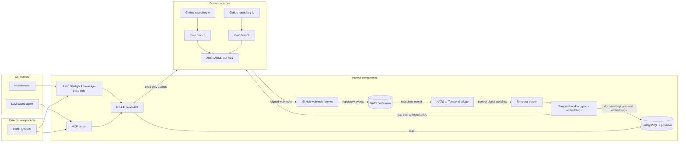
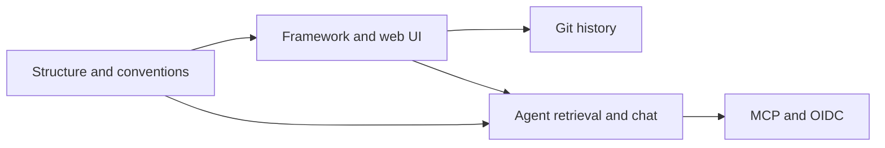

## What am I looking at?

This folder is the index for the knowledge base design, planning, decisions, and supporting documents. It describes a Git-native system for humans and agents to discover, search, and discuss documentation. Write capabilities remain a future phase.

## What architecture are we designing?

The main branches of one or more GitHub repositories are the content sources. Every `README.md` in those branches is included in the initial knowledge base. The GitHub proxy provides authenticated read-only access across the repositories. PostgreSQL stores a searchable local projection, document history, relationships, and embeddings. Document modification may be added later through a reviewed Git workflow.

## Where are the knowledge-base documents?

- [Astro Starlight architecture](/docs/scratchpad/knowledge-base/nodoc/overview) — historical proposal for documentation frontend, authentication, chat, and service boundaries.
- [GitHub proxy design](/docs/scratchpad/knowledge-base/github-proxy/overview) — multi-repository access, caching, webhooks, read-only retrieval, embeddings, and graph data.

New designs, decisions, runbooks, and journal entries should be added as documents under this folder and linked from this index.

## What are the project requirements?

1. Provide a top-level knowledge-base structure for discovery and design planning.
2. Use a Markdown-based documentation framework.
3. Support humans and agents through semantic search and chat-based iteration.
4. Provide an MCP server with OIDC authentication for external agents.
5. Surface Git history in the web interface.
6. Support dated, chronological journal entries.

## What are the milestones?

### M1 — Structure and conventions

Define folder taxonomy, document types, frontmatter, naming, links, and linting.

**Testable outcome:** Existing documents are mapped and conform to the conventions.

### M2 — Documentation framework and web UI

Choose and configure the documentation application, navigation, and page ordering.

**Testable outcome:** The development server serves all documents and supports browsing.

### M3 — Git history in the UI

Add per-document history, diffs, and author identity mapping.

**Testable outcome:** Every document shows who changed it, when, and what changed.

### M4 — Agent retrieval and chat iteration

Add embeddings, semantic search, and chat. Chat may propose changes, but document writes remain disabled in the initial phase.

**Testable outcome:** Users can ask questions and receive grounded answers from the knowledge base.

### M5 — MCP and OIDC

Expose search and document retrieval through MCP, with authenticated access for external agents.

**Testable outcome:** An external agent can authenticate and retrieve knowledge-base context.

## What is the dependency order?

Git history and agent features can proceed in parallel after the web UI is working.

## Which decisions are still open?

- Which documentation application should we use with the Next.js knowledge-base web app?
- Should the knowledge-base layout be chronological, ADR-focused, or a hybrid?
- Where should existing `logs/`, `factory/design/`, and `apps/design/` content live?
- When should MCP and chat be allowed to propose or apply document changes?
- Should search use self-hosted PostgreSQL with `pgvector`, or a hosted vector service?

## What are the current recommendations?

1. Use separate content, web, and services repositories.
2. Use Next.js for the full-stack web application.
3. Keep GitHub as the source of truth and use a GitHub App for access.
4. Use PostgreSQL with `pgvector` before adding a graph database.
5. Use webhook-first synchronization with polling as reconciliation.
6. Keep the initial system read-only; design future modifications as a separately authorized workflow.
