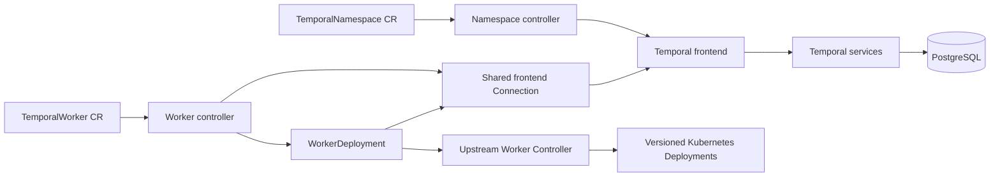

---

title: Temporal
description: Self-hosted Temporal as a platform service in the Nori Cloud cluster.
---

## Platform shape

The platform provides Temporal Server, persistence, Web UI, the operator, and
the upstream Worker Controller. `TemporalWorker` is a small namespace-wiring
wrapper; the upstream controller owns worker versions and rollouts. Temporal
namespaces are logical API resources, so the platform does not need a proxy for
a single self-hosted cluster.

## Documents

- [Temporal platform operator](/docs/scratchpad/temporal/temporal-platform-operator/overview)
- [Temporal namespace](/docs/scratchpad/temporal/temporal-platform-operator/temporal-namespace/overview)
- [Temporal Worker Controller](/docs/scratchpad/temporal/temporal-platform-operator/temporal-worker-controller/overview)
- [Temporal Server](/docs/scratchpad/temporal/temporal-server/overview)
- [Usage](/docs/scratchpad/temporal/usage/overview)
- [Temporal MCP](/docs/scratchpad/temporal/mcp/overview)
