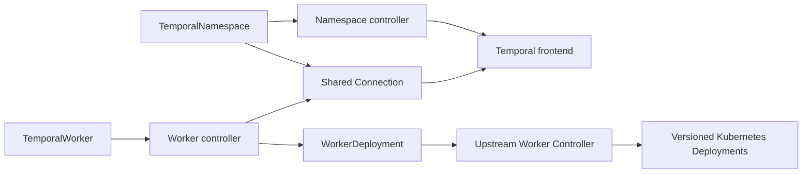

---

title: "Temporal Platform Operator"
description: "The operator manages logical Temporal namespaces and connects application workers to them in the self-hosted Temporal cluster."
---

The operator manages logical Temporal namespaces and connects application
workers to them in the self-hosted Temporal cluster.

## Controllers

The chart runs two deployments:

- **Namespace controller** registers and updates Temporal namespaces through the
  Temporal frontend API and waits for referenced workers during deletion.
- **Worker controller** resolves `temporalNamespaceRef`, reuses one shared
  `Connection` per `TemporalNamespace`, and creates one upstream
  `WorkerDeployment` per `TemporalWorker`.

The frontend address is a normal Helm value. It is an internal service address,
not a credential.

## Resource flow



## Wrapper contract

Users declare two resources:

- `TemporalNamespace` creates and owns the logical Temporal namespace.
- `TemporalWorker` references that namespace with `spec.temporalNamespaceRef`.

The worker controller translates the reference into upstream resources:

```text
TemporalWorker.spec.temporalNamespaceRef
  -> WorkerDeployment.spec.workerOptions.temporalNamespace
  -> WorkerDeployment.spec.workerOptions.connectionRef
```

`TemporalWorker.spec.template` is copied unchanged to
`WorkerDeployment.spec.template`. The wrapper does not rewrite the image,
container order, environment, or annotations. The upstream Worker Controller
adds its managed Temporal environment variables and owns versioning, routing,
rollouts, rollback, and cleanup.

Temporal namespaces are logical API resources. They are independent of
Kubernetes namespace boundaries and do not require a proxy. A worker is owned by
its referenced `TemporalNamespace`, so Kubernetes garbage collection and the
namespace controller's deletion checks preserve the dependency order.

## Implementation status

The implementation now matches the wrapper contract above:

- It reuses one `Connection` per `TemporalNamespace`.
- It copies the Pod template unchanged and leaves managed environment injection
  to the upstream Worker Controller.
- It forwards optional rollout and sunset settings while keeping safe defaults.

Remaining POC validation includes using a Worker Versioning-capable image,
running a sample workflow, and adding end-to-end lifecycle coverage.

See:

- [Temporal namespace](/docs/scratchpad/temporal/temporal-platform-operator/temporal-namespace/overview)
- [Temporal worker controller](/docs/scratchpad/temporal/temporal-platform-operator/temporal-worker-controller/overview)
- [Chart](/docs/scratchpad/temporal/temporal-platform-operator/chart/overview)
