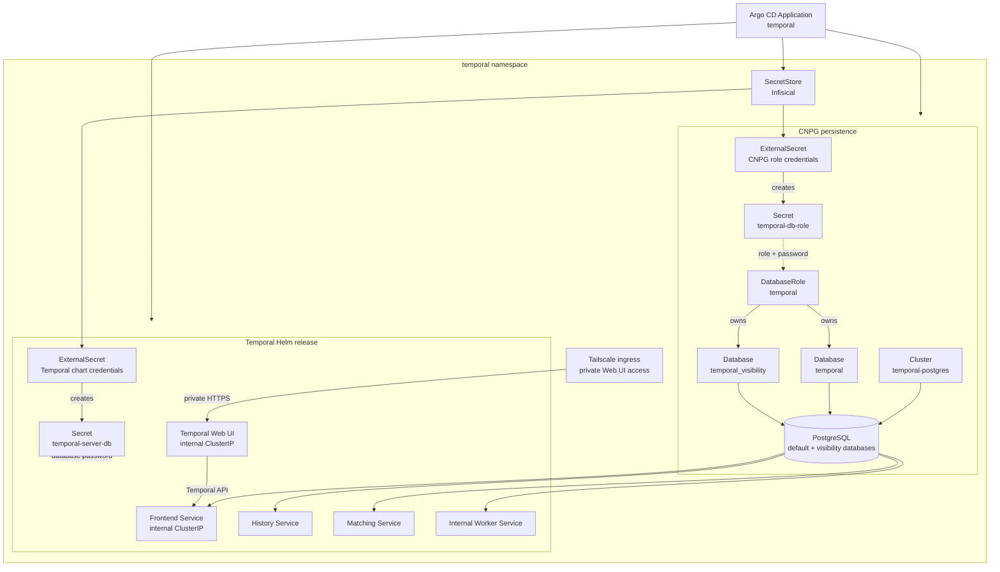

---

title: Temporal Server
description: High-level overview of the self-hosted Temporal Server platform component.
---

## What am I looking at?

Temporal Server is the stateful core of the Nori Cloud Temporal platform. It provides durable workflow execution, task queues, timers, retries, visibility, and the frontend API used by workers and clients.

The server runs as a group of cooperating services rather than one application process:

- Frontend — client and worker gRPC API.
- History — workflow execution state and event history.
- Matching — task queues and worker polling.
- Internal workers — Temporal's background processing.
- Web UI — private operational interface.

## What does the platform provide?

The platform provides and operates Temporal Server, PostgreSQL persistence, the Web UI, monitoring, backups, upgrades, and recovery procedures. Application workflow code and workers remain consumer-owned.

The server is deployed separately from `noperator`. The Temporal platform umbrella chart contains the pinned Temporal Server chart and the other Temporal platform components described in the surrounding documents.

## What resources will the server installation provide?

The first installation provisions one `temporal` namespace with one CloudNativePG cluster and the Temporal Helm release. The CNPG cluster is one PostgreSQL platform for both Temporal persistence stores; it is not two separate PostgreSQL clusters.

| Resource                                              | Purpose                                                                  |
| ----------------------------------------------------- | ------------------------------------------------------------------------ |
| `Namespace/temporal`                                  | Isolates the Temporal platform resources.                                |
| `SecretStore/temporal`                                | Gives External Secrets access to the Infisical project.                  |
| `CNPG Cluster/temporal-postgres`                      | Provisions one PostgreSQL cluster for Temporal.                          |
| `ExternalSecret/temporal-db-role`                     | Pulls CNPG role credentials from Infisical.                              |
| `Secret/temporal-db-role`                             | Supplies CNPG with the `temporal` username and password.                 |
| `ExternalSecret/temporal-server-db`                   | Pulls the Temporal chart database password from Infisical.               |
| `Secret/temporal-server-db`                           | Supplies the Temporal Helm release with its database password.           |
| CNPG `DatabaseRole/temporal`                          | Provisions the least-privileged Temporal database role using its Secret. |
| CNPG `Database` resources                             | Provision the `temporal` and `temporal_visibility` databases.            |
| Optional TLS Secret                                   | Secures frontend/internode traffic when TLS is enabled.                  |
| Temporal frontend, history, matching, internal worker | Execute and persist durable workflows.                                   |
| Temporal Web UI                                       | Private operational view of workflows and namespaces.                    |
| Tailscale ingress                                     | Provides private Web UI access at `temporal.hoki-sole.ts.net`.           |
| Internal Services                                     | Provide cluster-local connectivity; no public exposure.                  |

The initial development environment may use one CNPG instance with **8Gi** storage. A 4Gi volume is acceptable only for a disposable smoke test because Temporal history and visibility data grow over time. Start with about 100m CPU/512Mi memory requested and 500m CPU/1Gi memory limited for the CNPG instance, then tune from measurements. High availability and replica count are separate capacity decisions; the installation design keeps one CNPG cluster as the ownership boundary.

The server installation does not generate worker API keys or operator credentials.
Those belong to the platform integration layer and are not required for the
initial trusted in-cluster setup.

## What should I read next?

- [Installation plan](/docs/scratchpad/temporal/temporal-server/installation/overview) — self-hosted requirements, PostgreSQL, authentication, deployment stages, and validation.
- [Temporal platform operator](/docs/scratchpad/temporal/temporal-platform-operator/overview) — namespace and worker orchestration.
- [Temporal Worker Controller](/docs/scratchpad/temporal/temporal-platform-operator/temporal-worker-controller/overview) — versioned worker deployments.
- [Usage](/docs/scratchpad/temporal/usage/overview) — consumer onboarding example.
